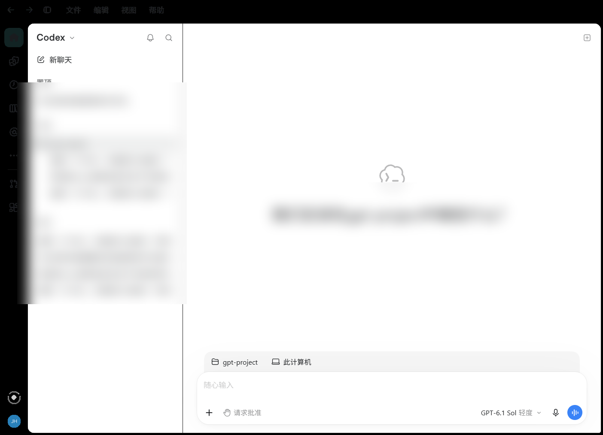

# Codex Desktop 汉化工具（codex-desktop-zh）

用纯 PowerShell 5.1 + Node.js 实现 **Codex Desktop（微软商店 MSIX 版）一键汉化**：
不修改 `WindowsApps`、不修改 `app.asar`、不复制安装目录，靠 **运行时注入官方 i18n** +
**官方语言设置项** 让界面显示简体中文，并提供安全启动、显示置前窗口、还原与只读诊断。

> 非官方社区项目，与 OpenAI / Microsoft 无任何关联。仅在你自己的电脑上、对你已安装的
> Codex Desktop 做运行时本地化，所有改动可一键还原。



---

## 已验证版本

| 项目 | 结果 |
|---|---|
| Codex Desktop | **26.1023.6621.0 / 26.1027.3384.0**（Microsoft Store，Windows 11，x64） |
| 界面语言 | 整页简体中文：菜单栏 **文件 / 编辑 / 视图 / 帮助**，侧栏 **新聊天 / 插件 / 自动化任务**，输入框 **随心输入** |
| CDP 验证 | `documentElement.lang=zh-CN`，中文 marker 命中 8 项，中文字符 229+，英文 marker 0 |
| 生效方式 | 26.1027+：官方 i18n 在启动后约 10~30 秒自动加载中文（`mode=official-locale`）；26.1023：运行时注入强制开启（`mode=runtime-injection`）。两种方式都只改内存/官方设置，不改安装文件 |
| 官方 i18n | Codex 内置 `zh-CN` 语言包被成功启用；**原生菜单也在官方 i18n 覆盖范围内，无需单独注入** |
| 主进程 inspector | 该版本不开放 `--inspect` 端口 —— **属正常现象**，不影响汉化（菜单由官方 i18n 覆盖） |

> 验证截图与原始数据由项目维护者在真机上采集。首次在你自己的机器上运行时，
> 请查看结果 JSON 与日志确认（见下文「结果与退出码」）。

---

## 重要限制（先读这里）

1. **界面汉化 = 运行时/官方 locale 生效**：
   - 26.1027+：安装后官方 i18n 会读取 `localeOverride`，通常在启动后 10~30 秒自动变中文；
   - 26.1023 等旧版：只有通过 `Install-CodexZh.ps1` / `Launch-CodexZh.ps1`（或对应 `.bat`）
     启动的那一次 Codex 会话会注入中文。从开始菜单直接打开可能回到英文，想再次使用中文
     请运行「启动汉化版.bat」。
2. **原生菜单由官方 i18n 覆盖**：真机验证菜单栏（文件/编辑/视图/帮助）会随界面一起变中文，
   不需要主进程注入。少数版本若官方 i18n 未覆盖某些菜单项，工具会尝试可选的主进程
   `--inspect` 注入（`assets/menu-script.js`）；该端口不开放时属正常情况，**不会**因此
   判定失败或「部分完成」。
3. **26.900+ 版本线不能改 `app.asar`**：官方对整包做完整性校验，任何字节改动都会让应用
   在数秒后退出（`0x80000003`）。本工具从设计上就不碰任何官方文件。
4. **需要 Node.js >= 22** 才能做运行时注入。没有 Node 时会自动降级为
   locale-only（只写官方语言设置）。

---

## 工作原理

```
Install-CodexZh.ps1
├─ 1. 检测 Codex（HKCU ...\AppModel\Repository\Packages 注册表 → Appx → shell:AppsFolder
│         → 便携版目录 → 运行中进程反查；不依赖 Get-AppxPackage）
├─ 2. 备份并写入 %USERPROFILE%\.codex\config.toml：
│         [desktop]
│         localeOverride = "zh-CN"        ← 官方设置键，启动时被 settingsStore 读取
├─ 3. 安全关闭正在运行的 Codex（优雅关闭 → PID+StartTime+Path 复验后才允许强杀；
│         路径无法验证的进程默认中止，绝不盲杀）
├─ 4. IApplicationActivationManager.ActivateApplication(AUMID, 参数) 启动：
│         --remote-debugging-address=127.0.0.1 --remote-debugging-port=<P1>
│         --inspect=127.0.0.1:<P2> --lang=zh-CN
├─ 5. lib/cdp.mjs（零 npm 依赖，Node 内置 fetch + WebSocket）：
│         a. 等待 http://127.0.0.1:<P1>/json/list 可用，枚举所有 Codex 渲染页面
│            （主窗口 index.html 优先，含 detached-window），按 electronBridge / #root /
│            文本长度打分；
│         b. 先等待官方 locale 生效（最多 30 秒）：较新版本官方 i18n 读取 localeOverride
│            后会自行加载中文，此时直接完成并跳过注入（mode=official-locale，不打乱页面）；
│         c. 若官方 locale 未生效：对每个 page target 用
│            Page.addScriptToEvaluateOnNewDocument 注册 assets/i18n-bootstrap.js，
│            Runtime.evaluate 立即执行并等待 Statsig 补丁完成；
│         d. 通过 assets/locale-script.js 触发 location.reload()，让新文档先跑 bootstrap
│            再初始化官方 i18n；
│         e. 刷新后**重新枚举页面的全部 page targets 并逐个验证**（最长 90 秒，
│            navigator.language / documentElement.lang / 中文 marker / 中文字符数 /
│            __codexZhI18nState），取最优结果；
│         f. 可选：尝试连接 --inspect 注入 assets/menu-script.js。
│            端口不开放时 menu.status=not-needed（官方 i18n 已覆盖菜单），不影响结果；
├─ 6. Win32 ShowWindow + SetForegroundWindow 显示并置前 Codex 主窗口（PID 校验），
│         避免窗口隐藏在后台让用户以为没启动；
└─ 7. 汇总 JSON（退出码 0=完整 / 1=部分 / 2=失败）+ 中文摘要 + 日志
```

为什么这样可以显示中文：Codex 官方内置了离线 `zh-CN` 语言包。较新版本中，写入官方设置键
`localeOverride = "zh-CN"` 后官方 i18n 会直接加载中文；旧版本中该能力被 Statsig 动态配置
`72216192` 的 `enable_i18n` 开关关掉（默认 `false`），此时 `i18n-bootstrap.js` 在渲染进程里
包装 Statsig 的 `getDynamicConfig` / `getLayer`，强制返回 `enable_i18n = true`、
`locale_source = 'SYSTEM'`，并覆盖 `navigator.language`，配合 `localeOverride` 让官方语言包
（含菜单文案）正常加载。整个过程只发生在内存里。

---

## 安全性

| 项目 | 说明 |
|---|---|
| 官方安装文件 | **零修改**。不写 `C:\Program Files\WindowsApps`、不碰 `app.asar`、不复制安装目录 |
| 会写入的文件 | 仅 `%USERPROFILE%\.codex\config.toml` 的 `[desktop] localeOverride`（写入前备份为 `config.toml.bak-zhcn`） |
| 日志 / 结果 / 状态 | 仅写 `%LOCALAPPDATA%\CodexZhCn\`（logs / results / state.json） |
| 不读取 | `auth.json`、token、API key、聊天记录；不联网请求 OpenAI |
| 不改动 | 模型配置、`[general]` 等其他配置段、注册表启动项、计划任务 |
| 关闭进程 | 只处理「路径明确属于当前 Codex 安装」的进程；路径读不到时**默认中止**，不盲杀；强杀前再次复验 PID+启动时间+路径 |
| 可逆性 | 运行「还原原版.bat」即可恢复配置备份或精确删除 `localeOverride`，不删除用户数据 |
| 权限 | 不需要管理员权限 / 不弹 UAC |

---

## 系统要求

- Windows 10 / 11 x64
- Codex Desktop（Microsoft Store 安装，包名 `OpenAI.Codex`；也支持便携版）
- Windows PowerShell 5.1（系统自带）；无需 PowerShell 7
- Node.js **>= 22**（推荐 24；用于运行时注入，零 npm 依赖）
- 第一次运行不需要管理员；不需要联网

---

## 目录结构

```
codex-desktop-zh/
├─ 一键汉化.bat              # 双击：安装并启动中文版
├─ 启动汉化版.bat            # 双击：再次以中文模式启动
├─ 还原原版.bat              # 双击：还原官方语言设置
├─ 诊断.bat                  # 双击：只读诊断（反馈问题用）
├─ Install-CodexZh.ps1       # 一键汉化主脚本
├─ Launch-CodexZh.ps1        # 已安装后再次中文启动
├─ Restore-CodexZh.ps1       # 还原原版
├─ Diagnostics.ps1           # 只读诊断
├─ lib/
│  ├─ Common.ps1             # 共享函数（检测/进程/窗口/配置/端口/日志/JSON）
│  └─ cdp.mjs                # 零依赖 Node CDP 驱动（多 target 注入 + 逐个验证 + 可选菜单）
├─ assets/
│  ├─ i18n-bootstrap.js      # 强制开启官方 i18n（Statsig 补丁 + navigator 覆盖）
│  ├─ locale-script.js       # 刷新页面使引导脚本生效
│  ├─ menu-script.js         # 可选：主进程原生菜单翻译（inspector 注入，官方 i18n 未覆盖时用）
│  └─ menu-translations.json # 菜单翻译字典（可自行扩充）
├─ tests/
│  ├─ SelfTest.ps1           # 不启动 Codex 的静态 / 单元自测
│  └─ fixtures/              # 配置与结果 JSON 测试夹具
├─ docs/
│  └─ diagnostics.md         # 诊断报告说明
├─ README.md / README.en.md
├─ LICENSE                   # MIT
├─ THIRD_PARTY_NOTICES.md
└─ CHANGELOG.md
```

---

## 使用

### 1. 下载

```powershell
git clone https://github.com/<your-name>/codex-desktop-zh.git
cd codex-desktop-zh
```

（或直接下载 ZIP 解压。仓库不含任何 Codex 官方文件。）

### 2. 一键汉化

双击 **`一键汉化.bat`**，或命令行：

```powershell
powershell -NoProfile -ExecutionPolicy Bypass -File .\Install-CodexZh.ps1
```

脚本会：检测 Codex → 备份并写语言设置 → 提示关闭 Codex（保存好正在编辑的内容）→
带调试参数重启 Codex → 注入中文界面 → 重新枚举页面逐个验证 → 显示并置前主窗口 →
输出结果与日志路径。

### 3. 再次以中文启动

双击 **`启动汉化版.bat`**（不会再写配置）。若 Codex 已在运行且不是中文会话，
脚本会在确认后关闭并重启它。

### 4. 还原原版

双击 **`还原原版.bat`**：恢复 `config.toml.bak-zhcn` 备份，或精确删除
`[desktop]` 段内的 `localeOverride` 行；按提示关闭 Codex。之后从开始菜单启动即为原版。

### 5. 诊断（只读）

双击 **`诊断.bat`**，会把只读诊断报告保存到
`%LOCALAPPDATA%\CodexZhCn\logs\diagnostics-*.txt`，不含任何敏感信息，便于反馈问题。

### 6. 自测（不启动 Codex）

```powershell
powershell -NoProfile -ExecutionPolicy Bypass -File .\tests\SelfTest.ps1
```

输出 `PASS/FAIL`；全部通过时退出码为 0。适合修改脚本或翻译字典后回归。

### 参数速查

| 脚本 | 常用参数 |
|---|---|
| `Install-CodexZh.ps1` | `-Yes` 跳过确认；`-LocaleOnly` 仅写配置；`-CodexPath <路径>`；`-NoPause`；`-AllowUnverified` |
| `Launch-CodexZh.ps1` | `-Yes`；`-Restart` 强制重启；`-CodexPath`；`-NoPause` |
| `Restore-CodexZh.ps1` | `-Yes`；`-ForceRemoveLocaleOverride` 强制删设置；`-StartOriginal` 还原后启动；`-NoPause` |
| `Diagnostics.ps1` | `-CodexPath`；`-Json` 输出 JSON 摘要；`-NoPause` |

---

## 结果与退出码

每次安装/启动/还原都会在 `%LOCALAPPDATA%\CodexZhCn\results\` 写结果 JSON
（`install-result.json` / `launch-result.json` / `restore-result.json`），
日志（含 CDP 详细日志 `cdp-*.log`）在 `%LOCALAPPDATA%\CodexZhCn\logs\`。

| 退出码 | 含义 |
|---|---|
| `0` | 完整：中文界面已确认生效（原生菜单由官方 i18n 覆盖；在已验证的 26.1023 上这是预期结果） |
| `1` | 部分：界面已部分中文 / 尚未完全确认（见结果 JSON 的 `renderer.verified` 与日志） |
| `2` | 失败：运行时注入失败或无法关闭/启动 Codex；结果里会给出 locale-only 降级说明、日志与诊断建议 |

结果 JSON 关键字段：

- `status`: `complete` / `partial` / `failed`
- `code`: `OK`、`PARTIAL_RENDERER`、`LOCALE_ONLY_FALLBACK`、`CDP_NOT_READY`、
  `SHUTDOWN_FAILED`、`NODE_UNAVAILABLE`、`CODEX_NOT_FOUND` 等
- `mode`: `runtime`（运行时完整模式）/ `locale-only`（仅官方语言设置）/ `none`
- `renderer.verify`: 最优页面的 `navigatorLanguage`、`documentLanguage`、`zhMatches`、
  `enMatches`、`chineseChars`、`i18nState`
- `renderer.verified`: 刷新后逐个页面 target 的验证结果（多窗口时便于排查）
- `menu`: `required=false`、`status`（`not-needed` 表示官方 i18n 已覆盖、无需注入）
- `checks`: 逐项检查结果（端口、target、补丁、刷新、语言、菜单）
- `logs.logFile` / `logs.cdpResultFile`: 日志与 CDP 原始结果文件路径

---

## 常见问题（FAQ）

**Q1：汉化后界面仍是英文？**
先看结果 JSON 的 `renderer.verify` 与 `code`：
- `NODE_UNAVAILABLE`：未安装 Node.js >= 22；装好后重新运行一键汉化。
- `CDP_NOT_READY` / `CDP_TARGET_TIMEOUT`：Codex 没接受调试参数（被杀软拦截、版本行为变化、
  或已有实例在运行）。完全退出 Codex 后重试；仍失败请附诊断报告提 Issue。
- `LOCALE_ONLY_FALLBACK`：只写入了语言设置，常见于无 Node 环境。

**Q2：界面中文了，但个别菜单项还是英文？**
在已验证的 26.1023 上，官方 i18n 已覆盖菜单栏（文件/编辑/视图/帮助），不需要主进程注入。
若你的 Codex 版本菜单未完全中文，工具会尝试可选的 `--inspect` 注入（需该版本开放端口）；
端口不开放时 `menu.status=not-needed`，属正常现象。可把诊断报告反馈以便补充词条。

**Q3：为什么每次都要用「启动汉化版.bat」？**
因为汉化是运行时注入，不做任何持久化修改（不装常驻程序、不改快捷方式、不写启动项）。
从开始菜单直接打开 Codex 时没有调试参数，自然不会注入。

**Q4：会不会影响模型、账号、聊天记录？**
不会。本工具不读取/不修改 `auth.json`、token、聊天记录、模型配置；只写
`config.toml` 的一个官方语言设置键。

**Q5：提示「还有进程无法验证路径，已中止」？**
为安全起见，工具不会强制结束读不到路径的 Codex 进程（可能是其他用户或受保护进程）。
请从 Codex 托盘图标完全退出后重试；确认无风险时可加 `-AllowUnverified`（仅关闭可验证进程）。

**Q6：杀毒软件/EDR 告警？**
脚本会启动本地调试端口并注入 JS 做界面本地化，行为类似开发者工具，可能触发启发式告警。
仓库全部源码可审计，不含混淆与网络请求；不放心可在虚拟机或自行审阅后运行。

**Q7：还原后界面还是中文？**
请完全退出 Codex 再启动（托盘右键 → 退出）。配置在启动时读取，运行中的会话不会变。

**Q8：窗口好像没打开 / 在后台？**
脚本在注入完成后会自动用 Win32 `ShowWindow` + `SetForegroundWindow` 显示并置前 Codex 主窗口
（仅操作属于当前 Codex 安装的进程窗口）。若仍未出现，请从任务栏点击 Codex 图标。

**Q9：便携版 / 非 Store 版能用吗？**
支持。用 `-CodexPath` 指定 `Codex.exe` / `ChatGPT.exe` 或安装目录。但便携版不会有
AUMID 激活步骤，脚本会直接带参数启动进程（同样不改任何文件）。

**Q10：`--inspect` 端口没开放是不是失败了？**
不是。26.900+ 版本通常不开放主进程 inspector，官方 i18n 已覆盖菜单，不需要该端口。
主进程菜单脚本只作为可选/未来兼容能力保留。

**Q11：macOS / Linux？**
不支持。本仓库只面向 Windows 的 Store(MSIX) / 便携版 Codex Desktop。

---

## 版本兼容

| 版本 | 界面汉化 | 原生菜单 | 说明 |
|---|---|---|---|
| `26.1027.3384.0`（**已验证**） | ✅ 官方 locale（10~30 秒内生效） | ✅ 官方 i18n 覆盖 | 26.900+ 受保护线，不修改 asar；官方 i18n 读取 `localeOverride` 后自动加载中文，无需注入 |
| `26.1023.6621.0`（**已验证**） | ✅ 运行时注入 | ✅ 官方 i18n 覆盖 | 26.900+ 受保护线；注入强制 `enable_i18n` 后刷新生效 |
| 其他 `26.900+` | 先官方 locale、必要时注入 | 多数由官方 i18n 覆盖 | 工具自动尝试并如实报告 |
| `< 26.900` | 运行时注入 | 同上 | 机制相同（本工具不做 asar 补丁路线） |
| 便携版 | 同机制 | 同上 | 需 `-CodexPath` |

界面汉化依赖官方内置 `zh-CN` 语言包；旧版本还依赖 Statsig 配置 id `72216192`。若未来版本改动
（例如更换 Statsig 全局名或配置 id），注入可能返回 `partial`；日志与结果 JSON 会显示
`patchedClients` / `patchedConfigs` / `candidates`、以及 `renderer.mode`
（`official-locale` / `runtime-injection`），便于更新适配。

升级 Codex 后建议重新运行一次「一键汉化.bat」（脚本幂等，可重复运行）。
更详细的诊断字段说明见 [docs/diagnostics.md](docs/diagnostics.md)。

---

## 卸载

1. 运行 **`还原原版.bat`**（恢复语言设置，不删用户数据）；
2. 删除本仓库文件夹；
3. 可选：删除 `%LOCALAPPDATA%\CodexZhCn\`（本工具自己的日志/结果/状态缓存）；
4. 不需要卸载 Codex，也不需要重装 —— 因为从未修改过官方文件。

---

## 开发与测试

- 无 npm 依赖、无构建步骤；改脚本后在 PowerShell 5.1 下运行 `tests/SelfTest.ps1`。
- 所有 `.ps1` 使用 UTF-8 BOM 保存（PowerShell 5.1 的要求）；`.bat` 使用 GBK/ASCII。
- 修改 `assets/menu-translations.json` 即可扩充菜单翻译，无需改代码。
- 修改 `assets/i18n-bootstrap.js` 时请保持「表达式型 IIFE + 返回 JSON 字符串」约定。
- 修改 `lib/cdp.mjs` 时保持「多 target 注入 + 刷新后逐个验证 + 最优结果」的流程。

架构上 PowerShell 只做编排（检测 / 配置 / 进程 / 窗口 / 端口 / 日志），所有 CDP 与中文
数据处理放在 Node 中，以避免 PowerShell 5.1 的编码与引号问题。

---

## 许可证与致谢

- 本项目：MIT（见 [LICENSE](LICENSE)）。
- 机制与部分资源参考了两个 MIT 开源项目，版权声明见
  [THIRD_PARTY_NOTICES.md](THIRD_PARTY_NOTICES.md)：
  - [shibaweidu/codex-desktop-zh](https://github.com/shibaweidu/codex-desktop-zh)
    （运行时注入机制、`i18n-bootstrap.js` / `menu-script.js` / 菜单字典原型）
  - [ukinch605/codex-zh-cn-agent](https://github.com/ukinch605/codex-zh-cn-agent)
    （`localeOverride` 写入/还原、版本线判定、结果文件协议思路）
- 本项目不包含、不分发任何 OpenAI / Codex 官方文件或语言包内容。

---

## 免责声明

本项目为第三方非官方工具，与 OpenAI、Microsoft 无关联，未获其背书。
汉化通过 Chromium DevTools Protocol 与 Electron 运行时接口实现，属于开发者调试范畴；
可能随 Codex 版本更新而失效。使用本工具即表示你理解并自行承担以下风险：
本地调试端口短暂开放、注入脚本可能被安全软件拦截、界面可能因版本变化出现
部分中英混杂或显示异常。请勿将本工具用于绕过官方授权、破解或再分发官方软件。
若 Codex 更新后行为异常，请先运行「还原原版.bat」并完全退出 Codex。
